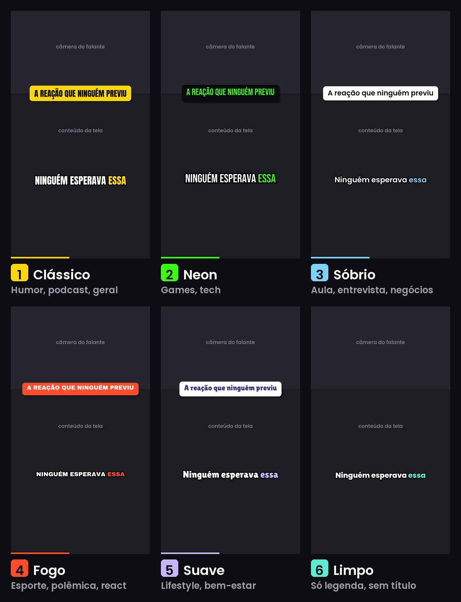

# Garimpo

Transforma uma gravação longa (live, podcast, aula, vídeo do YouTube, Twitch ou Kick, ou um arquivo seu) em **cortes verticais 9:16 prontos para postar**, com título e legenda palavra por palavra.

É uma skill do [Claude Code](https://claude.com/claude-code). O Claude ouve a gravação inteira no seu computador, escolhe os momentos que valem um corte, dá nota a cada um e monta os vídeos. Nada é postado: você recebe os arquivos.



## O que você recebe

Para cada corte escolhido, na pasta `garimpos/<id>/cortes/`:

| Arquivo | O que é |
|---|---|
| `NN-titulo.mp4` | O corte: 1080×1920, 30 fps, volume em −14 LUFS |
| `NN-titulo.txt` | Título, legenda do post, hashtags, link no segundo certo e a fala |
| `NN-titulo-folha.jpg` | Seis quadros do corte, para conferir antes de postar |

Mais uma resposta com os números (duração ouvida, momentos lidos, cortes feitos, tempo gasto) e os bons momentos que ficaram de fora, caso você queira pedir.

## Requisitos

- **Claude Code** (terminal, app desktop ou extensão de editor). A skill roda no seu computador; não funciona no claude.ai pelo navegador.
- **macOS, Windows ou Linux.**
- **Python 3.10 a 3.13.** Se o seu for outro, a skill busca um 3.12 sozinha.
- **Espaço em disco:** cerca de 2 a 4 GB na primeira vez (ambiente próprio, fontes e o modelo do Whisper). Os arquivos ficam em `~/.garimpo`, sem mexer no resto do computador.
- **Internet** para baixar a gravação e, uma vez, as dependências.

## Instalação

Coloque a pasta da skill em `~/.claude/skills/garimpo` (no Windows, `%USERPROFILE%\.claude\skills\garimpo`).

```bash
git clone https://github.com/gugu100codar/garimpo ~/.claude/skills/garimpo
```

Ou, de dentro do Claude Code, peça: `instala a skill desse repositório: https://github.com/gugu100codar/garimpo`. O Claude faz o clone no lugar certo (ele pede a sua permissão antes).

Abra uma sessão nova do Claude Code. A skill aparece como `garimpo`.

## Primeiro uso

1. Mande o pedido com um link ou arquivo: `garimpa essa live https://www.youtube.com/watch?v=...`
2. **Onboarding do visual (só na primeira vez).** Enquanto o computador é preparado e a gravação é ouvida, o Claude abre a folha de kits e pergunta, numa mensagem só, qual você prefere. Responda o número, uma cor se quiser outra e um @ para o pé do vídeo. "Pular" usa o Clássico. A escolha fica salva e a pergunta não volta.
3. **Preparação (só na primeira vez).** A skill cria o ambiente e baixa Whisper, modelo de rostos e fontes. Leva alguns minutos.
4. **Os cortes.** Uma live de quatro horas leva alguns minutos para ser ouvida num Mac com chip Apple. Em Windows ou Mac Intel o Whisper roda no processador e demora mais.

Outros pedidos que ela entende: `faz cortes desse podcast`, `tira os melhores momentos dessa aula`, `corta esse arquivo ~/Videos/live.mp4`, `quero 5 cortes`. Sem número, são três cortes por gravação.

## Os kits de visual

| # | Kit | Para quem | Fonte |
|---|---|---|---|
| 1 | Clássico | Humor, podcast, geral | Anton |
| 2 | Neon | Games, tech | Bebas Neue |
| 3 | Sóbrio | Aula, entrevista, negócios | Poppins SemiBold |
| 4 | Fogo | Esporte, polêmica, react | Archivo Black |
| 5 | Suave | Lifestyle, bem-estar | Lilita One |
| 6 | Limpo | Só legenda, sem título | Poppins ExtraBold |

A cor de destaque (a palavra dita, a tag do título e a barra de progresso) e a fonte podem ser trocadas em cima de qualquer kit. A legenda nunca passa de 140 px de cada borda, para não ficar sob os botões do Shorts, Reels e TikTok.

### Mudar o visual depois

- **De vez:** diga "muda o estilo" e escolha de novo. Ou: `python3 ferramentas/perfil.py --salvar --kit 2 --cor "#FF3366" --fonte 4 --marca "@meucanal"`.
- **Em uma gravação só:** `cortar.py ... --estilo neon`, ou um `garimpos/<id>/estilo.json` só com o que muda.
- **Ver o que está salvo:** `python3 ferramentas/perfil.py --mostrar`. Para apagar e refazer o onboarding: `--limpar`.

Chaves do `estilo.json` (valem sobre todo o resto):

| Chave | O que muda |
|---|---|
| `cor_destaque` | Palavra dita, tag e barra |
| `cor_legenda`, `cor_contorno` | Cor do texto e do contorno da legenda |
| `cor_titulo_fundo`, `cor_titulo_texto` | Cores da tag do título |
| `fonte` | Uma do catálogo (`anton`, `bebas`, `poppins-semibold`, `archivo-black`, `lilita`, `poppins-extrabold`) |
| `tamanho_legenda`, `tamanho_titulo` | Tamanho das letras, em pixels |
| `palavras_por_legenda`, `letras_por_legenda` | Quantas palavras aparecem de cada vez |
| `altura_legenda` | Posição vertical da legenda (0 = topo, 1 = pé) |
| `margem_lateral` | Distância mínima da legenda às bordas |
| `titulo`, `barra`, `maiusculas` | Ligar ou desligar |
| `marca` | Um nome ou @ pequeno no pé do vídeo |
| `volume` | Volume final, em LUFS |

### Kits e selos só seus

Quem quer um kit que não entra no catálogo público cria `~/.garimpo/estilos-pessoais.json`, no mesmo formato de `referencias/estilos.json`. Uma tag de título diferente da caixa lisa vai em `~/.garimpo/selos/<nome>.py`, e o kit a chama com `"selo": "<nome>"`. O arquivo oferece duas funções: `fonte(tamanho)`, que devolve a fonte do título (ou `None` para usar a do estilo), e `desenhar(linhas, tamanho, fonte_padrao)`, que devolve a imagem RGBA da tag. O `cortar.py` centra a tag na emenda e põe a sombra. Depois de mexer no catálogo, `python3 ferramentas/perfil.py --catalogo` redesenha as folhas.

## Como funciona

Quatro passos, cada um é um script em `ferramentas/`:

1. **Preparar** (`preparar.py`, uma vez): cria o ambiente com yt-dlp, OpenCV, Pillow, Whisper e as fontes.
2. **Ouvir** (`ouvir.py`): baixa só o áudio, transcreve com o Whisper no seu computador e mede volume, ritmo e, quando existe, o chat.
3. **Peneirar e escolher** (`peneirar.py`, `conferir.py`): uma peneira automática separa os trechos que merecem leitura. O Claude lê só esses, dá nota seguindo `referencias/criterios.md` e escreve a lista de momentos. Aqui está o julgamento; os scripts só ordenam a leitura.
4. **Cortar** (`cortar.py`): para cada momento, acerta o trecho pelo som, escolhe o enquadramento (`empilhado`: câmera em cima e conteúdo embaixo; `seguir`: recorte em volta do rosto; `desfocado`: sem rosto, vídeo no meio com fundo desfocado) e monta tudo com um único ffmpeg.

Regras que a skill segue: título e legenda saem do que é dito no trecho, sem invenção; nomes vêm dos metadados do vídeo, nunca da transcrição; nenhuma rede social é tocada.

## Privacidade

- Download, transcrição, análise e montagem acontecem no seu computador.
- O que sai dele: o download do vídeo (do site de origem) e, na preparação, dos pacotes, fontes e modelos (PyPI, GitHub, Hugging Face).
- O texto dos trechos que o Claude lê para dar nota passa pela sua sessão do Claude Code, como qualquer outra conversa.

## Uso responsável

O canal que você garimpa é de outra pessoa. Muitos têm regra ou programa próprio para cortes, e alguns pedem autorização. Veja se o criador aceita antes de postar, credite quem fala e respeite os termos da plataforma onde publica. A skill entrega arquivos e não posta nada por você. Você é quem responde pelo que publica.

## Problemas comuns

| Sintoma | O que fazer |
|---|---|
| `Falta preparar o computador` | Rode `python3 ferramentas/preparar.py` (no Windows, `python` ou `py`) |
| Vídeo com login ou restrição de idade | Peça para usar `--cookies chrome` (ou `safari`, `firefox`, `edge`) |
| Língua errada na transcrição | `--lingua pt` no `ouvir.py` |
| Whisper lento | `GARIMPO_MODELO=small` (ou `base`, `tiny`) troca por um modelo menor |
| Erro do Whisper no Windows | Instale o [Microsoft Visual C++ Redistributable](https://aka.ms/vs/17/release/vc_redist.x64.exe) |
| Só áudio (mp3, podcast sem imagem) | Transcreve e peneira, mas não vira corte vertical |
| Aviso `objc[...] Class AVF... is implemented in both` no Mac | Inofensivo (OpenCV e PyAV carregando a mesma biblioteca) |
| Enquadramento errado | Abra `trechos/NN-camera.jpg` e force `--modo seguir\|empilhado\|desfocado` ou `--camera x,y,largura,altura` |

Variáveis de ambiente: `GARIMPO_CASA` (onde fica o ambiente, padrão `~/.garimpo`), `GARIMPO_MODELO` (modelo do Whisper), `GARIMPO_MOTOR` (`mlx` ou `faster`).

## Estrutura

```
garimpo/
├── SKILL.md               instruções que o Claude segue
├── README.md  LICENSE
├── ferramentas/
│   ├── preparar.py        ambiente, Whisper, fontes
│   ├── ouvir.py           baixar, transcrever, medir
│   ├── peneirar.py        escolher o que ler
│   ├── conferir.py        conferir os momentos escolhidos
│   ├── cortar.py          enquadrar, legendar, montar
│   ├── perfil.py          onboarding e perfil visual
│   ├── estilo.py          kits, perfil e estilo.json
│   └── comum.py           ambiente, ffmpeg, yt-dlp, áudio
└── referencias/
    ├── criterios.md       como dar nota
    ├── estilos.json       kits e fontes do catálogo
    └── catalogo/          kits.jpg e fontes.jpg
```

## Licenças de terceiros

O código desta skill é MIT (veja `LICENSE`). A skill **não redistribui** nada abaixo: o `preparar.py` baixa cada item direto da fonte, e cada um segue a licença do seu autor. Confira as licenças atuais antes de empacotar ou redistribuir.

| Item | Licença |
|---|---|
| Fontes Anton, Bebas Neue, Poppins, Archivo Black, Lilita One (via [google/fonts](https://github.com/google/fonts)) | SIL Open Font License 1.1 |
| Modelo de rostos YuNet (via [opencv_zoo](https://github.com/opencv/opencv_zoo)) | MIT |
| [yt-dlp](https://github.com/yt-dlp/yt-dlp) | Unlicense |
| [OpenCV](https://opencv.org) | Apache 2.0 |
| NumPy | BSD 3-Clause |
| Pillow | MIT-CMU (HPND) |
| Whisper ([mlx-whisper](https://github.com/ml-explore/mlx-examples), [faster-whisper](https://github.com/SYSTRAN/faster-whisper) e os modelos da OpenAI) | MIT |
| [Deno](https://deno.com) | MIT |
| ffmpeg (do computador, ou o do `imageio-ffmpeg` quando falta) | LGPL ou GPL, conforme o build |

As imagens `referencias/catalogo/*.jpg` mostram texto desenhado com as fontes acima, o que a OFL permite.

## Licença

[MIT](LICENSE).
